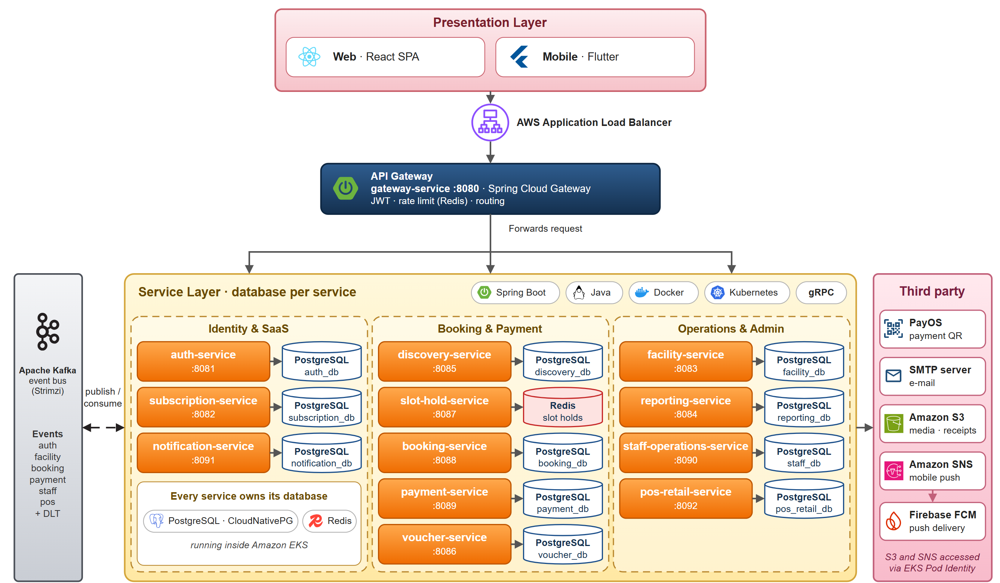

# fcourt-web



*Kiến trúc hệ thống FCourt*

Web frontend của FCourt, hệ thống đặt sân thể thao. Đây là ứng dụng single-page cho bốn vai trò: khách hàng (xem chi nhánh, giữ chỗ, đặt sân và thanh toán, quản lý đơn đặt), chủ sân (chi nhánh, sân, bảng giá, voucher, dashboard), nhân viên (thao tác tại quầy, sản phẩm) và super admin (người dùng, gói đăng ký, dashboard toàn nền tảng).

Production: https://fcourt.donan.site (S3 + CloudFront).

## Vai trò trong hệ thống FCourt

| Repo | Trách nhiệm |
|---|---|
| **fcourt-web** (repo này) | React SPA, gọi backend qua `/api` và `/ws-fcourt` cùng origin |
| `fcourt-backend` | Các microservice Spring Boot (auth, facility, booking, payment, notification, ...) |
| `fcourt-flutter` | Ứng dụng Android dùng chung backend |
| `fcourt-gitops` | Manifest Argo CD triển khai backend lên EKS |
| `fcourt-infra` | Terraform cho AWS (VPC, EKS, ECR, S3, CloudFront, Route 53, ACM, ...) |

Ở production, CloudFront phục vụ SPA này từ một S3 bucket private và định tuyến `/api/*` và `/ws-fcourt` tới backend trên cùng domain, nên trình duyệt không bao giờ gọi cross-origin. Phần AWS được định nghĩa trong `fcourt-infra` (`envs/shared`, `web-cdn.tf`).

Repo được tách từ thư mục `frontend/` của monorepo cũ (`group-project-sba301_fcourt`) bằng `git subtree split`. UI cũ chạy trên backend monolith; các khác biệt về API được theo dõi trong [docs/api/api-gap-report.md](docs/api/api-gap-report.md).

## Công nghệ

React 19, TypeScript, Vite, Tailwind CSS v4, React Router, TanStack Query, Axios, STOMP over WebSocket (`@stomp/stompjs`), Vitest + Testing Library, ESLint. Image production: nginx. Path alias `@/` trỏ tới `src`.

## Cấu trúc dự án

```text
fcourt-web
|- src
|  |- app           # router, providers, query client
|  |- common        # config (env.ts), constants (api-endpoints.ts), helpers
|  |- components    # UI dùng lại (gồm notifications bell)
|  |- context       # React context (staff session, ...)
|  |- hooks         # custom hook bọc query/state
|  |- layouts       # layout cấp trang theo từng vai trò
|  |- pages         # các trang theo route (admin, auth, booking, staff, super-admin, ...)
|  |- services      # axios client (services/http) và các module API
|  |- types         # type dùng chung
|  |- utils         # helper, lưu token
|- public           # file tĩnh
|- docs             # tài liệu, xem docs/README.md
|- .github/workflows
|  |- ci.yml        # lint, build, test
|  |- deploy-web.yml# deploy S3 + CloudFront (chạy trên main)
|- Dockerfile, nginx.conf   # container image (nginx, proxy /api tới API_UPSTREAM)
|- vite.config.ts   # build, Vitest, dev proxy tới các service
```

Quy ước: endpoint được khai báo trong `src/common/constants/api-endpoints.ts` hoặc trong các module `services/*`, không hard-code trong page.

## Yêu cầu

Node.js 20 (`.nvmrc`) và npm. Cần backend đang chạy để có dữ liệu thật: hoặc các service trên localhost (cổng 8081 đến 8092), hoặc một host từ xa (xem `DEV_BACKEND_HOST`).

## Cài đặt, chạy, test, build

```bash
cp .env.example .env     # chỉnh giá trị nếu cần
npm ci
npm run dev              # http://localhost:5173
```

| Lệnh | Mục đích |
|---|---|
| `npm run dev` | Vite dev server; proxy từng prefix `/api/...` tới cổng của service tương ứng (xem `vite.config.ts`) |
| `npm run build` | `tsc -b && vite build`, output trong `dist/` |
| `npm run preview` | Chạy `dist/` đã build ở local |
| `npm run lint` | ESLint |
| `npm test` | Vitest (`vitest run`) |

Container image (tùy chọn): `docker build -t fcourt-web .` rồi chạy với `API_UPSTREAM` trỏ tới origin của gateway/ALB.

## Cấu hình

Sao chép `.env.example` thành `.env`. `.env` và `.env.local` bị git-ignore; chỉ `.env.example` được commit.

| Biến | Ý nghĩa |
|---|---|
| `VITE_API_URL` | API base URL, mặc định `/api` (cùng origin). Phải kết thúc bằng `/api`. |
| `VITE_WS_URL` | URL STOMP WebSocket cho cập nhật slot realtime. Để trống nghĩa là cùng origin `/ws-fcourt`. |
| `VITE_GOOGLE_CLIENT_ID` | OAuth Web client ID cho đăng nhập Google. Để trống sẽ ẩn nút Google. Phải khớp với client mà auth service xác thực (`AUTH_GOOGLE_CLIENT_ID`), và origin của web phải nằm trong authorized JavaScript origins của client. |
| `DEV_BACKEND_HOST` | Chỉ dùng khi dev: host của các backend service, mặc định `localhost`. |
| `API_UPSTREAM` | Chỉ dùng cho container: origin của gateway/ALB, mặc định `http://gateway:8080`. |
| `NGINX_RESOLVER` | Chỉ dùng cho container: DNS resolver mà nginx sử dụng, mặc định `127.0.0.11`. |

Link đặt lại mật khẩu trong email trỏ tới route web `/reset-password?token=...`; hãy đặt `NOTIFICATION_RESET_PASSWORD_URL` của notification service thành `<web origin>/reset-password`.

## CI/CD và triển khai

- `ci.yml` chạy trên mọi pull request và khi push lên `dev` và `main`: `npm ci`, `npm run lint`, `npm run build`, `npm test`.
- `deploy-web.yml` chạy khi push lên `main` (và chạy thủ công). Workflow build với `VITE_API_URL=/api`, assume một AWS role qua OIDC, sync `dist/` lên S3 bucket (asset có hash trước, `index.html` sau cùng với `no-cache`) và invalidate CloudFront.
- Repository variables dùng khi deploy: `AWS_WEB_DEPLOY_ROLE_ARN`, `WEB_BUCKET`, `WEB_DISTRIBUTION_ID`, tùy chọn `VITE_GOOGLE_CLIENT_ID`.

Quy trình release: mở pull request từ `dev` sang `main` với tiêu đề `merge: release vX.Y.Z`. Merge PR này sẽ kích hoạt `deploy-web`.

## Kiểm thử

Unit test và component test dùng Vitest với jsdom (`npm test`). CI chạy lint, build và test trên mọi PR. Kết quả chạy end-to-end trên toàn hệ thống được ghi trong tài liệu của dự án, không nằm trong repo này.

## Đóng góp

- Branch: `main` (ổn định, được deploy) và `dev` (tích hợp). Tạo feature branch từ `dev` với prefix như `feat/`, `fix/`, `docs/`, `ci/`.
- Commit message và tiêu đề PR viết bằng tiếng Anh, theo dạng `type(scope): message` (ví dụ `fix(web): ...`). Squash merge dùng tiêu đề PR.
- Mở pull request vào `dev`; chờ CI pass. Release đi từ `dev` sang `main` như mô tả ở trên.
- Không bao giờ commit secret hoặc file `.env`.
